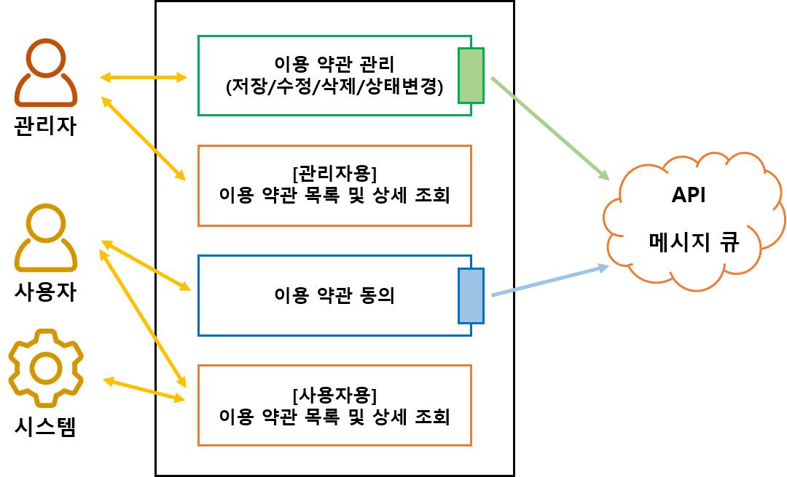

# 이용 약관 정보 관리

## 1. 개요
대부분의 웹 애플리케이션은 회원가입을 통해 사용자의 정보를 수집한다. 또한 웹 애플리케이션 내에서 어떤 서비스를 이용하는지, 서비스 이용 중에 발생한 문제가 무엇인지, 그 외의 애플리케이션 이용 및 관리를 위한 다양한 데이터를 수집한다.

웹 애플리케이션 관리자(담당자)는 사용자가 웹 애플리케이션을 이용하기 전에 어떤 정보가 수집되고 어떻게 활용하는지 사전에 고지해야 한다. 이를 위해 회원가입을 하는 과정에서 '서비스 이용 약관', '개인정보 활용 동의'와 같은 이용 약관 안내문을 사용자에게 제공하게 된다.

TERMS 프로젝트는 웹 애플리케이션에 적합한 '이용 약관 안내문(Terms of Use)'을 작성 및 관리하고 회원가입 기능에 즉각 적용할 수 있도록 지원하는 모듈이다. 웹 애플리케이션의 특성에 따라 다양한 '이용 약관 안내문'을 추가, 수정 및 삭제할 수 있으며, 가입하지 않은 일반 사용자에게도 '이용 약관 안내문'이 제공될 수 있도록 서비스를 제공한다.

## 2. 사전 요구사항

### 1) 개발 환경

#### OS
- Windows
- Linux
- MacOS

#### 필수 소프트웨어
- Spring boot
- JAVA
- MySQL

### 2) 실행 환경

#### Browser
- Chrom
- Edge
  - Internet Explorer는 미지원
- Firefox
- Safari

## 3. 시스템 구성도


## 4. 프로젝트 구조

### 1) 패키지 구조
```bash
kr.mook.terms
  ├─ common
  │    ├─ entity
  │    │   └─ Terms.java
  │    └─ util
  │        └─ TermsConverter.java
  ├─ admin
  │   ├─ management
  │   │   ├─ api
  │   │   │   └─ TermsManagementController.java
  │   │   ├─ dto
  │   │   │   ├─ TermsManagementRequestDto.java
  │   │   │   └─ TermsManagementResponseDto.java
  │   │   ├─ service
  │   │   │   ├─ TermsManagementService.java
  │   │   │   └─ TermsManagementServiceImpl.java
  │   │   └─ persistence
  │   │        └─ TermsManagementMapper.java
  │   └─ search
  │       ├─ api
  │       │   └─ TermsSearchController.java
  │       ├─ dto
  │       │   ├─ TermsSearchRequestDto.java
  │       │   └─ TermsSearchResponseDto.java
  │       ├─ service
  │       │   ├─ TermsSearchService.java
  │       │   └─ TermsSearchServiceImpl.java
  │       └─ persistence
  │           └─ TermsSearchMapper.java
  └─ user  
      ├─ agreements
      │   ├─ api
      │   │   └─ TermsAgreementsController.java
      │   ├─ dto
      │   │   ├─ TermsAgreementsRequestDto.java
      │   │   └─ TermsAgreementsResponseDto.java
      │   ├─ service
      │   │   ├─ TermsAgreementsService.java
      │   │   └─ TermsAgreementsServiceImpl.java
      │   └─ persistence
      │        └─ TermsAgreementsMapper.java
      └─ search
          ├─ api
          │   └─ TermsSearchController.java
          ├─ dto
          │   ├─ TermsSearchRequestDto.java
          │   └─ TermsSearchResponseDto.java
          ├─ service
          │   ├─ TermsSearchService.java
          │   └─ TermsSearchServiceImpl.java
          └─ persistence
              └─ TermsSearchMapper.java
```

### 2) 패키지별 설명
- `common`
  - 이용 약관 기능 구현에 필요한 공통 기능 관리
  - `entity`
    - 실제 테이블의 스키마와 매핑되는 객체 관리
        - entity 객체에는 비즈니스 로직 포함 가능
  - `util`
    - 프로젝트에서 공통으로 사용할 유틸리티를 관리
- `admin`
  - 관리자 전용 기능 관리
  -  및 조회 기능 제공
  - `management`
    - 이용 약관 저장/수정/삭제 기능 제공
  - `search`
    - 이용 약관 목록 및 상세 조회 기능 제공
- `user`
  - 사용자 전용 기능 관리
  - `agreements`
    - 이용 약관 동의 기능 제공
  - `search`
    - 사용 중인 이용 약관 목록 및 상세 조회 기능 제공

### 3) 테이블 구조

#### terms
- 테이블 명 : terms
- 컬럼 목록
    - **terms_id** : 이용약관 아이디, 기본 키(PK), 이용 약관 안내문을 관리하기 위한 고유 값이며, 숫자 형태로 제공된다. 아이디는 등록된 순서대로 발급된다.
    - **title** : 이용약관 제목, 이용 약관 안내문의 제목을 저장한다.
    - **contents** : 이용약관 내용, 이용 약관 안내문의 내용을 저장한다. 관리자가 텍스트 입력기를 통해 입력한 내용은 HTML 코드 형태로 저장되며, 그 외의 일반 텍스트나 JSON 또는 MARKDOWN 형식으로도 저장된다.
    - **content_type** : 내용 유형, 이용약관 내용의 유형을 저장한다. 단순한 TEXT부터 HTML, JSON, MARKDOWN 등의 타입을 지원한다.
    - **order_no** : 출력 순번, 이용 약관 목록 조회 시 정렬 순번을 저장한다.
    - **use_yn** : 사용여부, 이용 약관 안내문의 사용 여부를 저장한다. 사용 여부 값을 선택하지 않았을 경우를 대비하여 기본 값을 Y로 설정한다. 이용 약관 안내문을 사용하지 않을 경우 관리자가 값을 N으로 설정한다.
    - **require_yn** : 필수여부, 이용 약관 안내문의 필수 여부를 저장한다. 필수 여부가 Y인 경우 회원가입 시 이용 약관 안내문에 대한 동의를 필수로 선택해야 한다. 필수가 Y인 이용 약관 안내문에 동의하지 않으면 회원가입을 할 수 없다. 필수 여부가 N인 경우에는 이용 약관 안내문에 동의하지 않아도 회원가입을 진행할 수 있다.
    - **create_id** : 생성자 아이디, 이용 약관 안내문을 최초 작성 및 등록한 사용자의 아이디를 저장한다.
    - **create_date** : 생성일자, 이용 약관 안내문을 최초 작성 및 등록한 시간을 저장한다. 시간은 yyyy-MM-dd HH:mm:ss.SSS 형식으로 저장된다.
    - **update_id** : 수정자 아이디, 이용 약관 안내문을 수정한 사용자의 아이디를 저장한다. 이용 약관 안내문을 최초 등록할 때 수정자 아이디 값은 필수 입력되어야 하는 값이 아니지만 이용 약관 안내문의 제목이나 내용을 수정할 때에는 필수로 입력되어야 한다.
    - **update_date** : 수정일시, 이용 약관 안내문을 수정한 시간을 저장한다. 이용 약관 안내문을 최초 등록할 때 수정시간 값은 필수 입력되어야 하는 값이 아니지만 이용 약관 안내문의 제목이나 내용을 수정할 때에는 필수로 입력되어야 한다. 시간은 yyy-MM-dd HH:mm:ss.SSS 형식으로 저장된다.

## 5. 실행 방법

### 1) IDE
- IDE 대시보드를 통해 서버 실행

### 2) Terminal

#### Mac / Linux
```
# gradle 사용 시
./gradlew bootrun

# maven 사용 시
./mvnw spring-boot:runt
```

#### Windows
```
# gradle 사용 시
gradlew.bat bootRun 또는 ./gradlew.bat bootRun

# maven 사용 시
mvnw.bat spring-boot:run
```

## 6. API 사용 방법

### 1) 관리자

#### 가. 이용 약관 정보 저장
- 설명
  - 관리자가 웹 애플리케이션에서 사용할 이용 약관 정보를 작성하고 저장한다.
- API URI : /api/v1/admin/terms
- HTTP Type : POST
- Headers
  - Accept-Language : ko-KR
  - Content-Type : application/json
- Body
  ```json
  {
    "title" : "사이트 이용 시 정보 수집 동의",
    "contents" : "<div>'○○○ 플랫폼'은 사용자가 플랫폼을 이용할 때의 동작을 수집할 수 있습니다.</div>",
    "content_type" : "HTML",
    "order_no" : 1,
    "use_yn" : "Y",
    "require_yn" : "Y"
  }
  ```
- Response
  - Success
  ```json
  {
    "status" : "200",
    "message" : "이용 약관 정보({이용 약관 제목})가 저장되었습니다.",
    "terms_id" : 1
  }
  ```
  - Failed
  ```json
  {
    "status" : "400",
    "message" : "이용 약관 정보({이용 약관 제목})를 저장할 수 없습니다. {오류 원인 설명}"
  }
  ```

#### 나. 이용 약관 정보 수정
- 설명
  - 관리자가 저장된 이용 약관 정보를 수정한다.
- API URI : /api/v1/admin/terms/{id}
- HTTP Type : PUT
- Headers
  - Accept-Language : ko-KR
  - Content-Type : application/json
- Body
  ```json
  {
    "title" : "사이트 이용 시 정보 수집 동의",
    "contents" : "{'content' : '○○○ 플랫폼은 사용자가 플랫폼을 이용할 때의 동작을 수집할 수 있습니다.'}",
    "content_type" : "JSON",
    "order_no" : 2,
    "use_yn" : "N",
    "require_yn" : "N"
  }
  ```
- Response
  - Success
  ```json
  {
    "status" : "200",
    "message" : "이용 약관 정보({이용 약관 제목})가 수정되었습니다.",
    "terms_id" : 1
  }
  ```
  - Failed
  ```json
  {
    "status" : "400",
    "message" : "이용 약관 정보({이용 약관 제목})를 수정할 수 없습니다. {오류 원인 설명}"
  }
  ```

#### 다. 이용 약관 정보 삭제
- 설명
  - 관리자가 저장된 이용 약관 정보를 삭제한다.
- API URI : /api/v1/admin/terms/{id}
- HTTP Type : DELETE
- Headers
  - Accept-Language : ko-KR
  - Content-Type : application/json
- Response
  - Success
  ```json
  {
    "status" : "200",
    "message" : "이용 약관 정보({이용 약관 제목})를 삭제하였습니다.",
    "terms_id" : 1
  }
  ```
  - Failed
  ```json
  {
    "status" : "400",
    "message" : "이용 약관 정보({이용 약관 제목})를 삭제할 수 없습니다. {오류 원인 설명}"
  }
  ```

#### 라. 이용 약관 정보 상태변경
- 설명
  - 관리자가 저장된 이용 약관 정보를 사용할 것인지 사용하지 않을 것인지 상태를 변경한다.
- API URI : /api/v1/admin/terms/{id}
- HTTP Type : PATCH
- Headers
  - Accept-Language : ko-KR
  - Content-Type : application/json
- Body
  ```json
  {
    "use_yn" : "N"
  }
  ```
- Response
  - Success
  ```json
  {
    "status" : "200",
    "message" : "이용 약관 정보({이용 약관 제목})의 사용 여부를 '미사용'으로 변경하였습니다."
  }
  ```
  - Failed
  ```json
  {
    "status" : "400",
    "message" : "이용 약관 정보({이용 약관 제목})의 사용 여부를 변경할 수 없습니다. {오류 원인 설명}"
  }
  ```

#### 마. 관리자용 이용 약관 목록 조회
- 설명
  - 관리자는 저장된 이용 약관 목록을 조회할 수 있다.
  - 저장된 모든 값을 조회 결과로 확인할 수 있다.
  - 목록 조회 시 제목, 내용 유형, 사용 여부, 필수 여부, 생성(create) 시작일자와 생성(create) 종료일자 값을 전달하여 조건에 맞는 목록을 조회할 수 있다.
- API URI : /api/v1/admin/terms/search
- HTTP Type : POST
- Headers
  - Accept-Language : ko-KR
  - Content-Type : application/json
- Body
  ```json
  {
    "title" : "수집",
    "content_type" : null,
    "use_yn" : null,
    "require_yn" : null,
    "start_date" : "2026-01-01",
    "end_date" : "2026-11-01"
  }
  ```
- Response
  - Success
  ```json
  {
    "status" : "200",
    "message" : "이용 약관 목록을 조회하였습니다.",
    "count" : 10, 
    "list" : [
      {
        "terms_id" : 1,
        "title" : "사이트 이용 시 정보 수집 동의",
        "contents" : "{'content' : '○○○ 플랫폼은 사용자가 플랫폼을 이용할 때의 동작을 수집할 수 있습니다.'}",
        "content_type" : "JSON",
        "order_no" : 1,
        "use_yn" : "N",
        "require_yn" : "N",
        "create_id" : 123,
        "create_date" : "2026-01-01 14:00:00",
        "update_id" : 123,
        "update_date" : "2026-02-01 14:00:00"
      }, {
        "terms_id" : 2,
        "title" : "개인 정보 수집 동의",
        "contents" : "<p>○○○ 플랫폼은 사용자 개인 정보를 수집하고 있습니다. 이에 동의 하십니까?</p><p></p>",
        "content_type" : "HTML",
        "order_no" : 2,
        "use_yn" : "Y",
        "require_yn" : "Y",
        "create_id" : 123,
        "create_date" : "2026-01-01 14:00:00",
        "update_id" : 123,
        "update_date" : "2026-02-01 14:00:00"
      }, {
        ...
      }
    ]
  }
  ```
  - Failed
  ```json
  {
    "status" : "400",
    "message" : "이용 약관 목록을 조회할 수 없습니다. {오류 원인 설명}"
  }
  ```

#### 바. 관리자용 이용 약관 상세 정보 조회
- 설명
  - 관리자는 저장된 이용 약관의 상세 정보를 조회할 수 있다.
  - 저장된 모든 값을 조회 결과로 확인할 수 있다.
- API URI : /api/v1/admin/terms/search/{id}
- HTTP Type : GET
- Headers
  - Accept-Language : ko-KR
  - Content-Type : application/json
- Response
  - Success
  ```json
  {
    "status" : "200",
    "message" : "이용 약관({이용 약관 제목}) 정보를 조회하였습니다.",
    "terms" : {
      "terms_id" : 1,
      "title" : "사이트 이용 시 정보 수집 동의",
      "contents" : "{'content' : '○○○ 플랫폼은 사용자가 플랫폼을 이용할 때의 동작을 수집할 수 있습니다.'}",
      "content_type" : "JSON",
      "order_no" : 1,
      "use_yn" : "N",
      "require_yn" : "N",
      "create_id" : 123,
      "create_date" : "2026-01-01 14:00:00",
      "update_id" : 123,
      "update_date" : "2026-02-01 14:00:00"
    }
  }
  ```
  - Failed
  ```json
  {
    "status" : "400",
    "message" : "이용 약관 정보를 조회할 수 없습니다. {오류 원인 설명}"
  }
  ```

### 2) 사용자

#### 가. 사용자 이용 약관 동의
- 설명
  - 사용자가 회원 가입을 할 때 애플리케이션의 이용 약관에 동의 또는 미동의한 정보를 저장한다.
- API URI : /api/v1/terms/agreement
- HTTP Type : POST
- Headers
  - Accept-Language : ko-KR
  - Content-Type : application/json
- Body
  ```json
  [
    {
      "agreement_id" : 1,
      "user_id" : 1,
      "terms_id" : 1,
      "agree_yn" : 'Y',
      "agree_date" : "2026-01-01"
    }, {
      "agreement_id" : 2,
      "user_id" : 1,
      "terms_id" : 2,
      "agree_yn" : 'N',
      "agree_date" : "2026-01-01"
    }, {
      ...
    }
  ]
  ```
- Response
  - Success
  ```json
  {
    "status" : "200",
    "message" : "이용 약관 정보의 동의 여부를 저장하였습니다. {동의 : n건, 미동의 : n건}"
  }
  ```
  - Failed
  ```json
  {
    "status" : "400",
    "message" : "이용 약관 정보의 동의 여부를 저장할 수 없습니다. 관리자에게 문의하시기 바랍니다."
  }
  ```

#### 나. 사용자용 이용 약관 목록 조회
- 설명
  - 사용자는 현재 사용 중인(use_yn=Y) 이용 약관 목록을 조회할 수 있다.
  - 목록 조회 시 이용 약관 아이디, 제목, 내용 유형, 출력 순번, 필수 여부 값을 조회할 수 있다.
  - 제목과 필수 여부 값을 전달하여 조건에 맞는 목록을 조회할 수 있다.
- API URI : /api/v1/terms/search
- HTTP Type : POST
- Headers
  - Accept-Language : ko-KR
  - Content-Type : application/json
- Body
  ```json
  {
    "title" : "수집",
    "require_yn" : null,
  }
  ```
- Response
  - Success
  ```json
  {
    "status" : "200",
    "message" : "이용 약관 목록을 조회하였습니다.",
    "count" : 10, 
    "list" : [
      {
        "terms_id" : 1,
        "title" : "사이트 이용 시 정보 수집 동의",
        "contents" : "{'content' : '○○○ 플랫폼은 사용자가 플랫폼을 이용할 때의 동작을 수집할 수 있습니다.'}",
        "content_type" : "JSON",
        "order_no" : 1,
        "require_yn" : "N"
      }, {
        "terms_id" : 2,
        "title" : "개인 정보 수집 동의",
        "contents" : "<p>○○○ 플랫폼은 사용자 개인 정보를 수집하고 있습니다. 이에 동의 하십니까?</p><p></p>",
        "content_type" : "HTML",
        "order_no" : 2,
        "require_yn" : "Y"
      }, {
        ...
      }
    ]
  }
  ```
  - Failed
  ```json
  {
    "status" : "400",
    "message" : "이용 약관 목록을 조회할 수 없습니다. 관리자에게 문의하시기 바랍니다."
  }
  ```

#### 다. 사용자용 이용 약관 상세 정보 조회
- 설명
  - 사용자는 현재 사용 중인(use_yn=Y) 이용 약관 목록을 조회할 수 있다.
  - 목록 조회 시 이용 약관 아이디, 제목, 내용 유형, 출력 순번, 필수 여부 값을 조회할 수 있다.
  - 제목과 필수 여부 값을 전달하여 조건에 맞는 목록을 조회할 수 있다.
- API URI : /api/v1/terms/search/{id}
- HTTP Type : GET
- Headers
  - Accept-Language : ko-KR
  - Content-Type : application/json
- Response
  - Success
  ```json
  {
    "status" : "200",
    "message" : "이용 약관 정보를 조회하였습니다.",
    "list" : {
      "terms_id" : 1,
      "title" : "사이트 이용 시 정보 수집 동의",
      "contents" : "{'content' : '○○○ 플랫폼은 사용자가 플랫폼을 이용할 때의 동작을 수집할 수 있습니다.'}",
      "content_type" : "JSON",
      "order_no" : 1,
      "require_yn" : "N"
    }
  }
  ```
  - Failed
  ```json
  {
    "status" : "400",
    "message" : "이용 약관 정보를 조회할 수 없습니다. 관리자에게 문의하시기 바랍니다."
  }
  ```